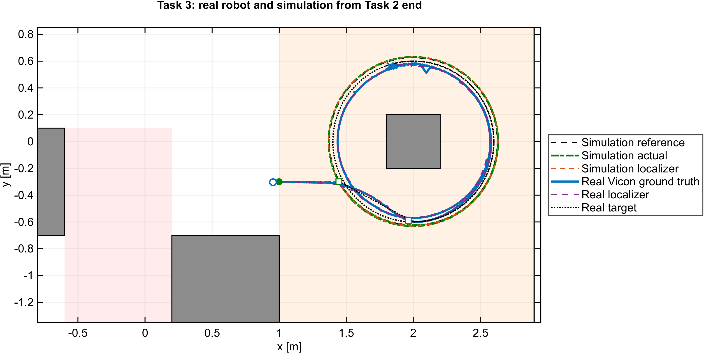
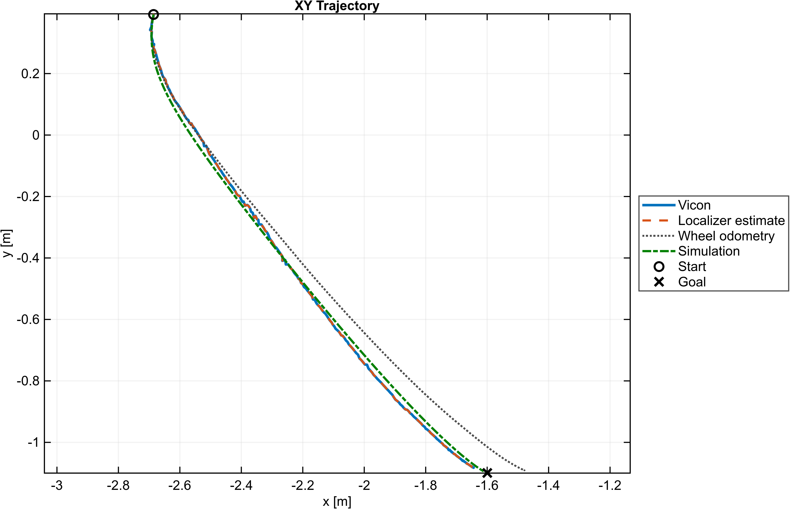
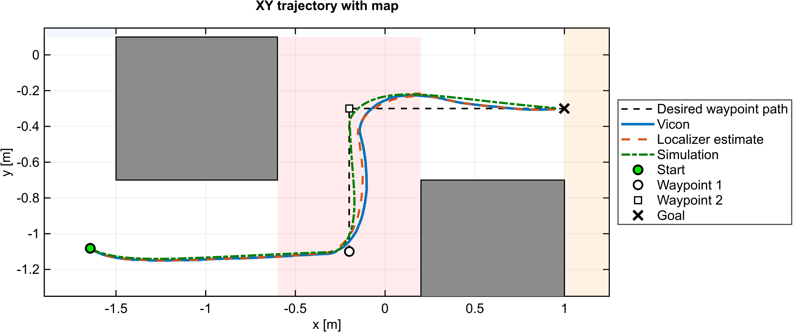
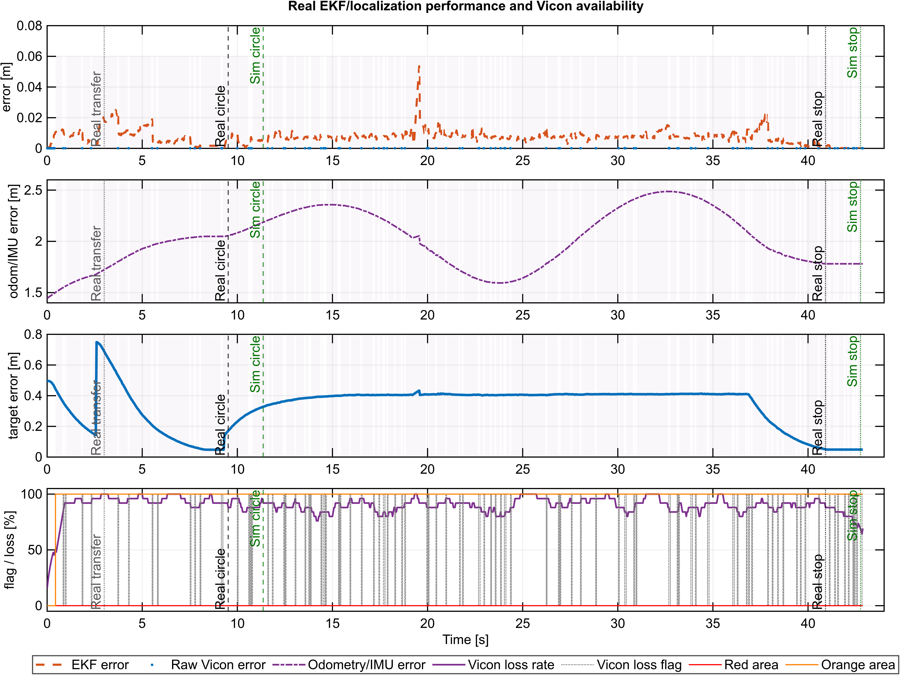
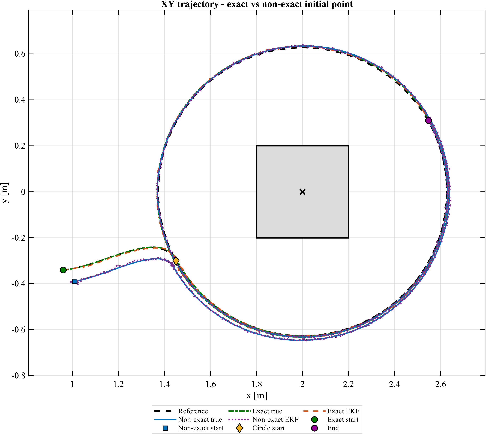
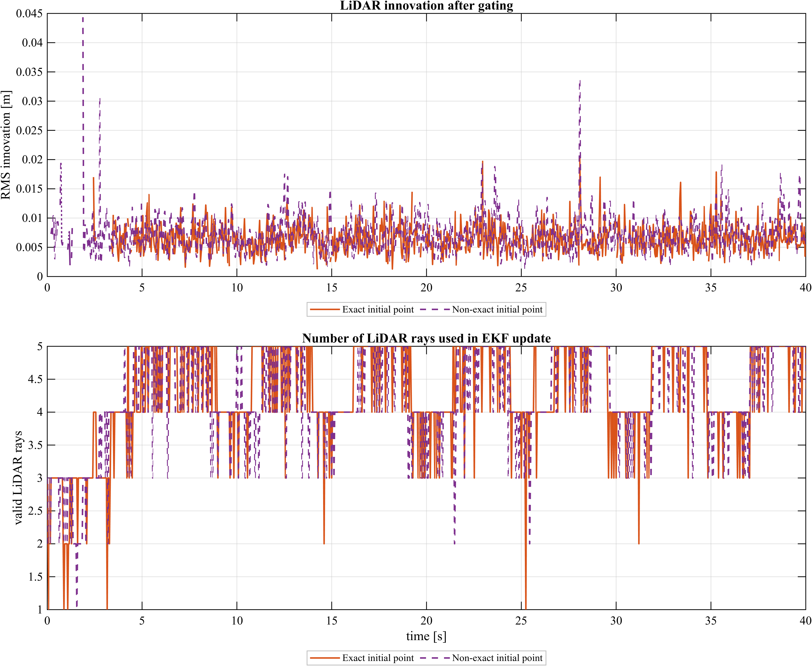

# TurtleBot Mobile Robot Control — Posture Regulation, Waypoint Navigation and EKF Localization under Degraded Motion Capture

Autonomous operation of a differential-drive TurtleBot when the motion-capture
system cannot be trusted: a posture-regulation phase, a waypoint navigation
phase that crosses a **noisy** Vicon region, a circular tracking phase inside a
region where **90 % of the Vicon measurements are missing**, and — in simulation
— a LiDAR-based EKF that replaces the motion-capture system entirely.

Developed as part of academic coursework at the University of Padova, Italy —
Robotics Laboratory, A.Y. 2025–2026.

  
## What this is

A four-task final activity carried out on a real, lab-built TurtleBot with an
external Vicon motion-capture system and a ROS bridge to Simulink. The robot
must reach a target pose, navigate to a second target through a region where
the mocap measurement is corrupted by Gaussian noise, then circle a cube for
one and a half turns inside a region where the mocap measurement is dropped
90 % of the time. Finally the same scenario is solved without any mocap
feedback at all, using a LiDAR-based EKF against a known map.

Every task was first built and tuned in simulation, then executed on the
hardware where a real run exists. The reported numbers come from the recorded
runs, and the check in `tools/verify_metrics.py` recomputes them from those logs
without MATLAB.

## Capabilities

1. **Posture regulation** on a nonholonomic platform with the Astolfi polar
   control law, saturating both linear and angular velocity, with a
   rotate-in-place completion phase at the target.
2. **Waypoint navigation** through a fixed map: a state machine sequencing two
   waypoints and the goal, with position/heading switch thresholds and a
   timeout that prevents the robot from stalling at an intermediate point.
3. **Trajectory tracking** of a circular reference (radius 0.63 m, 1.5 turns,
   tangent heading) using a robot-frame error feedback law with feedforward.
4. **Pose estimation** fusing wheel odometry and IMU, with an EKF correction
   step gated on Vicon validity — so a lost or noisy measurement does not
   corrupt the estimate.
5. **LiDAR-EKF localization** (Task 4, simulation) with a nonlinear range model
   to the known cube walls, adaptive innovation gating, an analytic measurement
   Jacobian, and automatic selection of the initial covariance depending on
   whether the initial pose is trusted.
6. **Model-based simulation** of the measurement degradation itself: the
   simulator reproduces the noisy region (σ = 0.02) and the lossy region
   (p_loss = 0.9) so that a controller can be tested before touching hardware.

## Results at a glance

| Task | Environment | Result |
|---|---|---|
| 1 — posture regulation | real robot, 3 initial poses | final position error **0.0478 / 0.0491 / 0.0473 m** (all below the 0.05 m threshold); heading threshold **not** reached within the run (0.569 / 0.993 / 0.467 rad) |
| 2 — navigation through noisy Vicon | real robot | final error **0.0478 m / 0.066 rad**; localization RMSE **0.0168 m** overall, **0.0235 m** inside the noisy region; no measurement loss in this run |
| 3 — circular tracking under 90 % Vicon loss | real robot | EKF localization RMSE **0.0087 m** against **2.04 m** for dead reckoning (99.6 % better); 89 loss intervals; peak wheel command 9.41 rad/s within the 10 rad/s limit |
| 4 — localization without mocap | simulation | tracking RMSE **0.0072 m** (exact init) vs **0.0071 m** (wrong init); localization RMSE degrades 0.0076 → 0.0120 m while the LiDAR update recovers the error |

Full tables, and the figures for each task, are in [`docs/RESULTS.md`](docs/RESULTS.md).
The 31-page submitted report is in [`report/Ali_Shavakhi_Final_Report.pdf`](report/Ali_Shavakhi_Final_Report.pdf).

  
  
## How it works

The control architecture is a cascade: a **reference/task manager** produces a
target pose and feedforward velocities; a **controller** turns the pose error
into body velocities; a **kinematic conversion** turns those into wheel speeds;
the **plant** (real robot or unicycle model) integrates them; a **localizer**
produces the pose estimate that closes the loop.

```
 Task manager ──► Controller ──► kin2omegawheels ──► TurtleBot / unicycle model
      ▲                 ▲                                     │
      │                 └──── q_est ◄── Localizer (EKF) ◄─────┘
      │                                     ▲
      └────────── t ────────────────────────┴── Vicon / IMU / wheels / LiDAR
```

The controller is the same structure in all four tasks, with a mode switch:
polar posture regulation (`ctrl_mode = 1`) and robot-frame trajectory tracking
(`ctrl_mode = 2`). The full equations, gains and switch thresholds are in
[`docs/METHOD.md`](docs/METHOD.md); the extracted MATLAB source of every block
is in [`src/model_code/`](src/model_code/).

Because a Simulink model is a zip package, the block diagram can be read
outside MATLAB — `docs/MODEL_STRUCTURE.md` is generated from the `.slx` files
themselves, and `src/model_code/` holds the embedded MATLAB Function blocks
extracted verbatim.

## Software and dependencies

| Component | Version used | Needed for |
|---|---|---|
| MATLAB | R2024b | all models (`*.slx` saved in the 2024b format) |
| Simulink | R2024b | simulation and code generation |
| Simulink ROS Toolbox | — | the real-robot model (ROS node publish/subscribe) |
| ROS | Noetic | hardware runs only |
| Python ≥ 3.9 with NumPy + SciPy | numpy 2.5, scipy 1.18 (tested) | `tools/verify_metrics.py`, `tools/static_checks.py` |

Python requirements: `pip install -r requirements.txt`.

## Repository layout

```
src/matlab/            initialisation scripts (fa.m, FA_modified.m), draw_robot.m, analysis pipeline
src/simulink/          the five models: four task simulations + the real-robot model
src/model_code/        MATLAB Function blocks extracted verbatim from the models
data/real/             real-robot logs: raw SimulationOutput objects + exported structs
data/simulation/       exported simulation runs (Tasks 1-4)
data/metrics/          the metric tables the report was written from
figures/               figures per task, as generated by the analysis pipeline
report/                the submitted 31-page final report (PDF)
docs/                  method, results, model structure, selection, test plan, changes
tools/                 extraction, verification and static-check scripts
```

## Installation and execution

Nothing here needs to be installed to *read* the project: the model structure,
the algorithm code and the results are all plain text.

To reproduce the simulation in MATLAB:

1. Open MATLAB R2024b with Simulink (and the ROS Toolbox for the real-robot model).
2. `cd src/matlab` and run `fa.m` — it loads the map, goals, gains, sampling
   time and the `is_real_robot` switch into the workspace.
3. Open the model for the task you want, e.g. `src/simulink/task3_simulation.slx`,
   and press Run. Each model reads the workspace variables created by `fa.m`
   (or its own `*_simulink_init.m` for Task 4).
4. The analysis scripts under `src/matlab/analysis/` regenerate the figures and
   the metric tables from the exported `.mat` files.

To check the numbers without MATLAB:

```bash
pip install -r requirements.txt
python tools/verify_metrics.py     # 28 recomputed metric checks
python tools/static_checks.py      # repository-level guards
python tools/model_inventory.py --check
```

## Simulation and experimental results

The real runs were executed on the lab TurtleBot with Vicon motion capture,
a control loop at `Ts = 0.04 s`, a 0.03 m wheel radius, a 0.165 m wheel base and a 10 rad/s
wheel-speed limit. Task 1 was repeated from three initial poses; Tasks 2 and 3
used the recorded run of the same session; Task 4 exists in simulation only.

  
  
  
## Limitations

- **Task 4 was solved in simulation only.** The LiDAR-EKF is not validated on
  the hardware; the report says so and this README repeats it.
- **The final heading threshold was not met on the real robot in Task 1.** All
  three runs reached the position tolerance (0.05 m) but not the heading
  tolerance within the recorded duration; the extended simulation reaches both.
- **The real-robot model cannot run here.** It needs the lab's Vicon interface
  block and a ROS master on the laboratory network; neither is included, and
  the scaffold belongs to the course.
- **No re-identification of the wheel parameters** was performed in the final
  activity: nominal `r = 0.03 m`, `d = 0.165 m` are used, and calibration error
  shows up as odometry drift, which the EKF is there to absorb.
- **Simulink models are binaries.** They are readable as structure (via the
  generated inventory and the extracted code) but a reviewer cannot diff a
  block diagram the way they can diff a script.

## Future improvements

- Validate the LiDAR-EKF on the hardware with the same scenario to remove the
  simulation-only limitation.
- Add the heading threshold to the on-line stopping criterion by extending the
  run time or raising `k_theta` in the final approach.
- Replace the fixed waypoint sequence with a planner that uses the map
  obstacles rather than hand-placed waypoints.
- Log time-stamped covariance and innovation statistics so filter consistency
  can be tested (NEES) rather than only assessed visually.

## My contribution

Individual work (group number 3 was the lab group identifier; the activity was
executed and reported individually): the Simulink models, the controllers, task
managers, localizers, the analysis pipeline, the real-robot runs and the
31-page report are mine. The course provided the TurtleBot platform, the Vicon
interface block, the ROS message bus generated by Simulink and the lecture
material; those files are **not redistributed** here — see
[`THIRD_PARTY_NOTICES.md`](THIRD_PARTY_NOTICES.md) and
[`docs/SELECTION.md`](docs/SELECTION.md).

## Licence

MIT for the code and documentation in this repository; the submitted report is
included as the author's own work. Files that are not mine are not included.
See [`LICENSE`](LICENSE) and [`LICENSE-SCOPE.md`](LICENSE-SCOPE.md).
