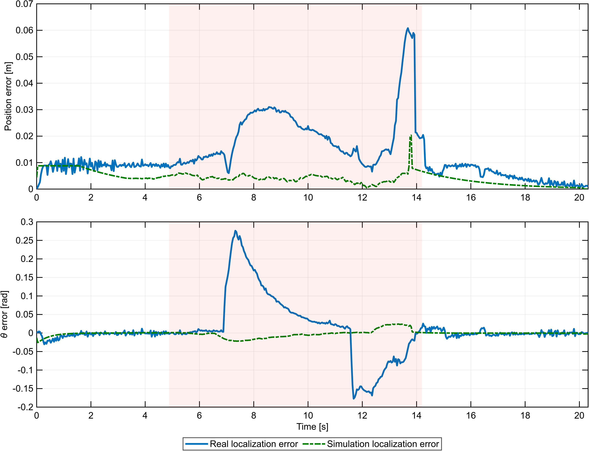

# Results

Every number in a table marked **verified** below is recomputed by
`tools/verify_metrics.py` from the recorded data in `data/`, and the table it is
compared against is named in the marker. Tables marked **reported** come from
the submitted report and were *not* independently recomputed here — the reason
is stated in each case.

Nominal parameters for every run: wheel radius `r = 0.03 m`, wheel base
`d = 0.165 m`, sampling time `Ts = 0.04 s`, wheel-speed limit `10 rad/s`.
Real runs use the lab TurtleBot and the Vicon motion-capture system.

## Task 1 — posture regulation, three real runs

Three real runs from different initial poses inside the initial area, all
terminated at the fixed run duration; the errors are measured against Vicon
and against the target `(−1.60, −1.10, 0)`.

<!-- verified:data/metrics/task1_three_real_runs.csv -->

| Run | initial pose (x, y, θ) | final Vicon position error | final heading error |
|---|---|---|---|
| 1 | −2.5548, 0.5352, −1.5599 | 0.047817 m | 0.568551 rad |
| 2 | −1.7048, 1.0135, −1.5607 | 0.049097 m | 0.993088 rad |
| 3 | −2.6852, 0.4125, −1.4487 | 0.047263 m | 0.467022 rad |

* All three runs met the 0.05 m position threshold.
* None met the heading threshold within the recorded run — the report states
  this explicitly, and the extended simulation of run 3 reaches both thresholds.
* Peak commanded wheel speed in run 3 is 10.0 rad/s, i.e. the actuator limit
  was reached but not exceeded.

  

<!-- verified:data/metrics/task1_summary.csv -->

Simulation of the same initial pose: the run is 12.44 s long and the simulated
robot reaches the 0.05 m / 0.0497 rad thresholds at 25.4 s; at the real run's
end the simulated error was 0.023371 m, and at the end of the extended
simulation 0.00099 m.

## Task 2 — navigation through the noisy-Vicon region

One real run (the recorded third test of the session) from the Task 1 target
through the red region to `(1.00, −0.30, 0)`.

<!-- verified:data/metrics/task2_report_numbers.csv -->

| Quantity | Value |
|---|---|
| localization RMSE, whole run | 0.016838 m |
| maximum localization error | 0.060836 m |
| localization RMSE inside the red (noisy) region | 0.023476 m |
| final position error at the goal (Vicon) | 0.047836 m |
| final heading error at the goal | 0.066234 rad |
| peak commanded wheel speed | 10.0 rad/s |
| Vicon samples lost in this run | 0 of 509 |

The estimate is roughly 40 % worse inside the noisy region than outside it,
which is the expected behaviour: the measurement covariance is inflated inside
the red area, so the filter leans on the odometric prediction there.

  
  

## Task 3 — circular tracking in the 90 % Vicon-loss region

One real run: transfer to the circle start point, 1.5 turns around the cube at
`(2.00, 0.00)` with radius 0.6265 m, then stop.

<!-- verified:data/metrics/task3_real_vs_sim.csv -->

<!-- verified:data/metrics/task3_filter_metrics.csv -->

| Quantity | Real robot |
|---|---|
| EKF localization RMSE (samples with a valid Vicon fix) | 0.008134 m |
| stored EKF RMSE over the run | 0.008725 m |
| share of the run without a Vicon fix | 89.6552 % |
| final distance to the target pose | 0.048619 m |
| peak commanded wheel speed | 9.4106 rad/s |
| dead-reckoning (IMU-only) RMSE over the same run | 2.0378 m |

With nine measurements in ten missing, the filter still localizes the robot to
under a centimetre over the samples where the measurement is available, while
pure dead reckoning drifts by metres. That comparison — not the tracking error
— is the point of the task.

  
  

## Task 4 — localization without motion capture (simulation)

Two simulations of the same scenario, differing only in whether the EKF starts
from the exact initial pose or from a perturbed one, both with the LiDAR
correction replacing Vicon entirely.

<!-- reported -->

| Quantity | exact initialisation | perturbed initialisation |
|---|---|---|
| tracking RMSE over 40 s | 0.0072 m | 0.0071 m |
| localization RMSE | 0.0076 m | 0.0120 m |
| maximum LiDAR innovation | 0.0197 m | 0.0301 m |
| mean valid rays per update | 4.31 | 4.30 |
| valid-update share | 86.81 % | 97.30 % |
| peak wheel speed | 7.4042 rad/s | 7.7267 rad/s |

**Why this table is not recomputed:** the Task 4 exports
(`data/simulation/task4_*.mat`) contain a `Simulink.SimulationOutput` object
stored as an opaque MCOS value — SciPy can read the file but not that object,
so the run data cannot be re-derived outside MATLAB. `tools/verify_metrics.py`
therefore checks only that the five exports exist and are of that type, and
prints that Task 4 was not recomputed. The values above are quoted from the
submitted report, `report/Ali_Shavakhi_Final_Report.pdf` §Task 4.

  
  

## Verification summary

`python tools/verify_metrics.py` — 28 checks, all passing:

* Tasks 1–3: every metric in the verified tables above is recomputed from the
  exported logs and compared with the metric table the report was written from.
* Model integrity: all six `.slx` files are readable packages, and the
  extracted code in `src/model_code/` re-extracts byte-identically from them.
* Provenance: every published file matches `docs/PROVENANCE.sha256`, i.e. it is
  byte-identical to the frozen intake copy (the two files with repaired
  comments are excluded from that manifest and covered by `docs/CHANGES.md`).

What was **not** run anywhere: MATLAB, Simulink, ROS and the hardware. There is
no MATLAB on the machine where this repository was prepared, and an Octave
substitution would not be evidence about Simulink. See `docs/TEST_PLAN.md`.
